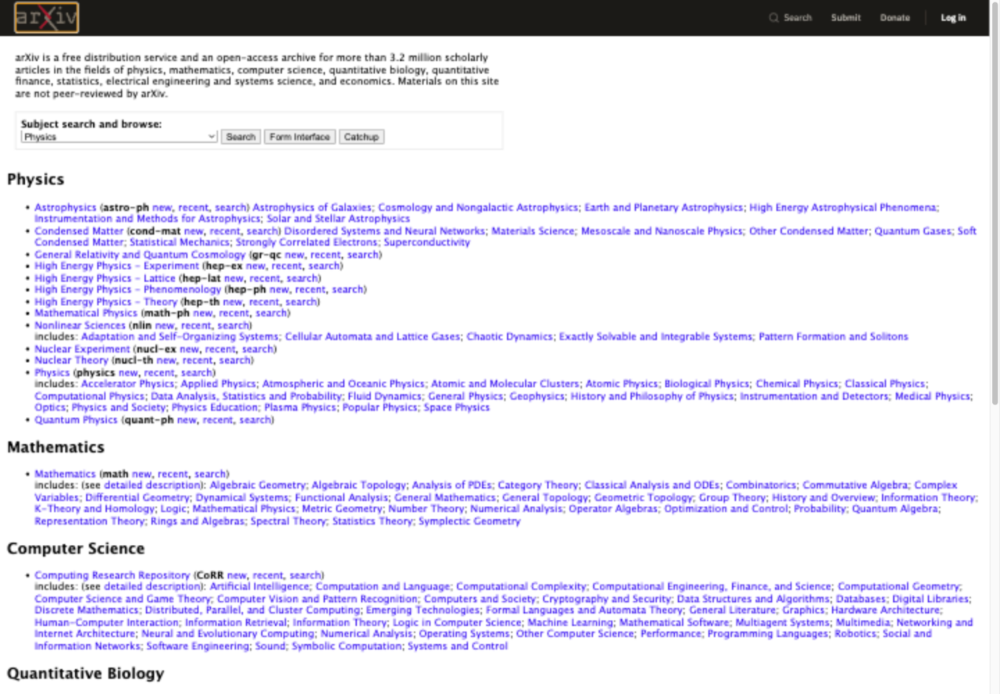
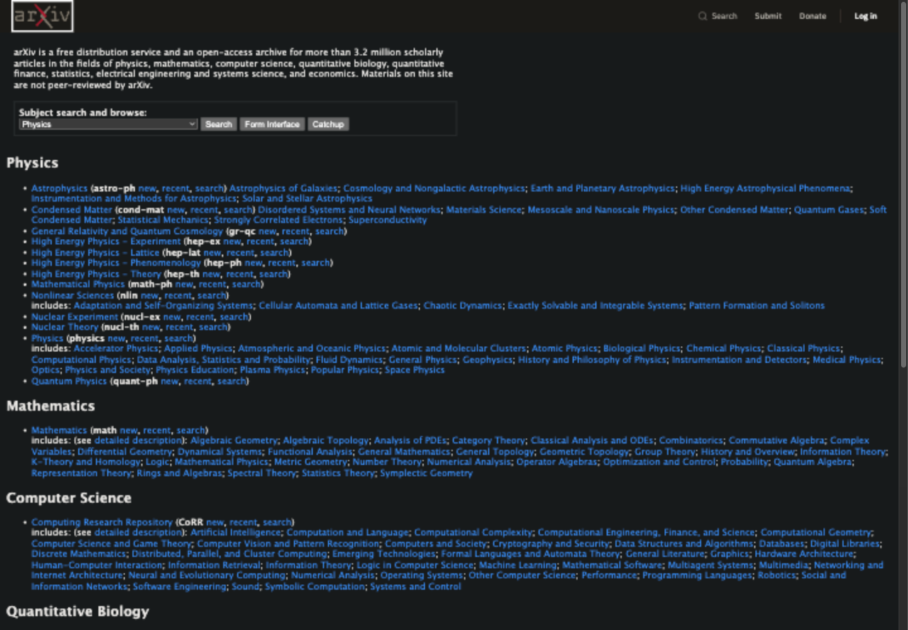

# Shade Toggle

One remembered dark-mode choice per website. A small Chrome extension with one
toggle, local preferences, and a locally bundled Dark Reader engine. Free, MIT licensed,
no account or options screen. Version 0.1.0 is a local prerelease, not yet in the store.




These real arXiv rendering previews are examples, not installed-extension evidence.
[Capture provenance and third-party rights](docs/site/assets/README.md).

## Run locally

Requires Node 22 or newer, npm and Python 3 for deterministic ZIP packaging.

```sh
npm ci
npm run build
```

Open `chrome://extensions`, enable Developer mode, choose Load unpacked and select
`dist/`. Visit an ordinary HTTP(S) site and open Shade Toggle. Enable Dark mode and
approve Chrome's site permission prompt to remember that exact hostname. Turn it
off to restore the page. Remove site access through Chrome's extension settings.

```sh
npm test
npx playwright install chromium
npm run test:extension
npm run package
```

The ZIP is `release/shade-toggle-0.1.0.zip`. Packaging rebuilds production files with
fixed ZIP metadata and an explicit allowlist. [Verification record](docs/verification.md)
distinguishes passing Chromium fixtures from outstanding stable Chrome checks.

## Access and limits

Installation requests activeTab, scripting and storage. Optional website access is
requested when enabling a site. Hostname preferences stay in Chrome local storage.
The renderer processes page content/styles locally and does not transmit them.
[Privacy policy](PRIVACY.md) · [Permission justifications](store/listing.md).

Protected Chrome pages, the Chrome Web Store, PDFs and non-HTTP(S) pages cannot be
changed. Already-dark pages are preserved. Complex backgrounds, inaccessible cross-origin
styles, closed shadow roots and canvas may need site-specific work. Photos/video remain
unchanged in tested fixtures; compatibility on every website is not guaranteed.

WCAG 2.2 AA contrast thresholds are tested on popup states and controlled rendered
fixtures. This is not ADA certification or a guarantee about arbitrary websites.
See the measured ratios and remaining manual checks in [verification](docs/verification.md).

## Project and publication

[Source and issues](https://github.com/qwertypants/chrome-simple-dark-mode) ·
[Contributing](CONTRIBUTING.md) · [Security](SECURITY.md) ·
[Code of conduct](CODE_OF_CONDUCT.md) · [Changelog](CHANGELOG.md).

The static homepage and privacy page are in `docs/site/`. Intended policy URL:
https://qwertypants.github.io/chrome-simple-dark-mode/privacy.html, published and verified 2026-10-28.
GitHub Pages is live. Chrome Web Store submission has not occurred.
[Store review checklist](store/review-checklist.md) tracks the remaining release gates.

Original code is [MIT licensed](LICENSE). Dark Reader's MIT notice is retained in
[third-party notices](THIRD_PARTY_NOTICES.md) and the ZIP. Website screenshots are
excluded from the project license. Shade Toggle is independent of Dark Reader and arXiv.
